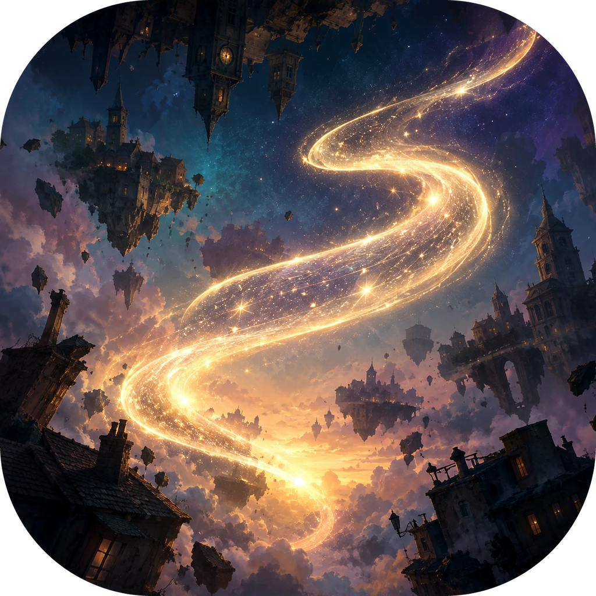

<p align="center"></p>

<h1 align="center">Gravity Rush 2 — port nativo para PC</h1>

<p align="center">
  <a href="#english"><b>English below</b></a> ·
  <a href="https://github.com/HayatoG/gr2_pc/releases/tag/nightly">Download</a> ·
  <a href="https://www.youtube.com/@hayatog-dev">YouTube</a> ·
  <a href="https://discord.gg/UMkdMYZh9g">Discord</a>
</p>

<p align="center"><a href="https://github.com/HayatoG/gr2_pc/actions/workflows/build.yml"></a></p>

**Gravity Rush 2** (PS4, CUSA03694, update 01.11) rodando no PC com imagem, som e controle, a 30 FPS estáveis e sem emulador de CPU. O código original do jogo roda nativo no processador. O sistema do PS4 é reimplementado, e a GPU é traduzida para Vulkan. Usa o mesmo núcleo do port de [The Last Guardian](https://github.com/HayatoG/tlg_pc), também da Japan Studio.

> **Nenhum arquivo do jogo vem com este projeto.** Para jogar, você precisa da sua própria cópia, tirada do seu PS4.

Por **HayatoG** · YouTube [@hayatog-dev](https://www.youtube.com/@hayatog-dev) · Discord [discord.gg/UMkdMYZh9g](https://discord.gg/UMkdMYZh9g)

| | |
|---|---|
|  |  |
|  |  |
|  |  |


<sub>Capturas na resolução nativa (1920×1080), direto da GPU, no Linux com uma RTX 2060, com o jogo em português.</sub>

## Novidades

- **Processadores Intel:** o jogo não fecha mais logo no começo (instrução ilegal, `0xc000001d`). O processador do PS4 tem o SSE4A da AMD, que nenhum Intel tem, e o `eboot.bin` usa 96 `EXTRQ`. Agora o port reescreve essas instruções e as emula (junto com MOVBE, BMI1 e LZCNT, se faltarem) quando o processador não as tem. Em CPUs Ryzen nada muda.
- **Launcher bilíngue** (português e inglês, automático ou escolhido), com o **idioma do jogo** (voz e texto) escolhido ali.
- **Linhas pretas:** o contorno do geometry shader com adjacência, que gerava os traços pretos perto dos personagens, fica desligado por padrão ([`docs/BUG_LINHAS_PRETAS.md`](docs/BUG_LINHAS_PRETAS.md), [#1](https://github.com/HayatoG/gr2_pc/issues/1)).
- **Sensor de movimento:** o giroscópio do DualShock 4/DualSense funciona direto. Em controles sem sensor, um toque em Share (ou L3+R3) liga o "modo sensor": o analógico esquerdo inclina o controle e X/A sacode. No teclado, T/G inclinam e Y sacode.
- **Analógicos:** zona morta de 10% contra drift (`TLG_STICK_DEADZONE`), e o último controle usado é o que vale.
- **Touchpad sem touchpad:** segure View/Select (ou Tab) e mova o analógico direito (ou as setas) para deslizar o dedo; um toque rápido continua sendo clique.
- **Desempenho:** o FPS não cai mais com o tempo (as variantes de shader agora se repetem), e transições parciais de imagem repetidas são puladas.
- **Cache de shaders automático:** fica em `user/cache/`, junto dos saves (em Linux e Windows; o cache antigo de `~/.local/share/shadPS4` ou `user/user/` é trazido sozinho na primeira partida). A pasta leva a versão do tradutor de shaders, e o cache antigo é apagado sozinho depois de uma atualização. Para recompilar tudo, o launcher tem o botão **Limpar cache de shaders** (ou `./run_gr2.sh --clear-shader-cache`); ele apaga só os shaders compilados deste jogo, nunca saves ou configurações.

## Status

| Área | Estado |
|---|---|
| Boot, abertura com créditos e legendas | ✅ Funciona |
| Título, menu e gameplay | ✅ 30 FPS, 1080p nativo |
| Áudio | ✅ Com o `libSceNgs2.sprx` do firmware do seu console + Audio3d reimplementado |
| Idioma | ✅ Escolhido no launcher (legendas e menus em português testados) |
| Controle | ✅ DualSense, DualShock 4, Xbox e 8BitDo via SDL3; sensor de movimento real ou simulado e touchpad simulado |
| Linhas pretas perto dos personagens | 🔧 Contorno do geometry shader desligado por padrão ([#1](https://github.com/HayatoG/gr2_pc/issues/1)) |
| Saves e mundo aberto | ⏳ Testando ([#6](https://github.com/HayatoG/gr2_pc/issues/6)) |
| Linux | ✅ Testado (Nobara/Fedora 44) |
| Windows | 🧪 Build automático, ainda sem teste em jogo ([#5](https://github.com/HayatoG/gr2_pc/issues/5)) |
| macOS (Apple Silicon) | 📋 Planejado ([#5](https://github.com/HayatoG/gr2_pc/issues/5)) |


<sub>FPS, pior quadro e draws por quadro a cada 5 s, tirados do log do port (`TLG_FRAME_STATS=1`). Gerado por `scripts/session_chart.py`.</sub>

## Download

O [**build nightly**](https://github.com/HayatoG/gr2_pc/releases/tag/nightly) é gerado pelo GitHub Actions a cada mudança e substitui o anterior:

- **Linux x86-64** (glibc 2.39+: Ubuntu 24.04, Fedora 40, SteamOS 3.6 ou mais novos): `gr2-linux-x86_64.tar.gz`
- **Windows 10/11 64 bits**: `gr2-windows-x86_64.zip`

## Arquivos do jogo necessários

Tudo vem do **seu** PS4 (GoldHEN + Itemzflow). Nada disso vai no download. Use **Gravity Rush 2 CUSA03694 (EUA) com o update 01.11**, montado numa pasta só, com o jogo base e o update por cima. São ~28 GB.

| Arquivo | Vem de | Tamanho | Para quê |
|---|---|---|---|
| `eboot.bin` | update 01.11 | 28 MB | o código do jogo (tem que ser o do 1.11) |
| `sce_module/libc.prx`, `libSceFios2.prx`, `libSceJobManager.prx` | jogo base | 1,7 MB | bibliotecas do próprio jogo |
| `sysdata/libSceSecure.prx` | jogo base | pequeno | criptografia do próprio jogo |
| `sce_sys/` (`param.sfo`, `playgo-chunk.dat`, `icon0.png`, `pic1.png`) | base + update | ~5 MB | metadados, instalação e a arte do launcher |
| `Gravite2_Chunk0.psarc`, `Gravite2_Chunk1.psarc` | jogo base | 10 + 15,8 GB | conteúdo principal |
| `Gravite2_Patch_Chunk0.psarc`, `Gravite2_Patch_Chunk1.psarc` | update 01.11 | 0,5 + 1,6 GB | correções do update |
| `sce_discmap.plt`, `sce_discmap_patch.plt` | update 01.11 | pequenos | mapa de arquivos |

**Do firmware do console (opcional, para ter som):** `libSceNgs2.sprx`, de `/system/common/lib/` do seu PS4. Ele vai na pasta `system_lib/` ao lado do executável. Ainda é necessário: o áudio sem esse arquivo está em [#8](https://github.com/HayatoG/gr2_pc/issues/8).

**Como montar a pasta:**
1. No Itemzflow, faça o dump do jogo (`CUSA03694`) e do update (`CUSA03694-patch`) para um pendrive exFAT.
2. No PC, copie a pasta do jogo base e depois copie o conteúdo do update **por cima**, substituindo os arquivos. Também dá para usar `scripts/make_game_view.py <base> <update> <saída>`, que monta a pasta com links, sem ocupar espaço.
3. Confira os tamanhos. Arquivos acima de 4 GB vindos pelo FTP do GoldHEN 2.2 chegam cortados, então use o pendrive.

A lista completa, que também vai nas notas de cada Release, está em [`docs/ARQUIVOS_NECESSARIOS.md`](docs/ARQUIVOS_NECESSARIOS.md).

## Como jogar

1. Extraia o pacote e coloque o `libSceNgs2.sprx` na pasta `system_lib/`.
2. Abra o **Gravity Rush 2**, escolha a pasta do jogo e o idioma do jogo (e, se quiser, o da interface), e clique em **Jogar**.
3. No jogo, **F10** liga o contador de FPS, e **Insert** (ou R3 + L2 no controle) abre o menu do port.

Variáveis de ambiente do port usam o prefixo `GR2_` (o nome antigo `TLG_` continua valendo; se os dois estiverem definidos, vale o `GR2_`). `GR2_ISA_REWRITE` controla a reescrita de instruções que o processador não tem: sem definir, só as que faltam (SSE4A em qualquer Intel); `0` nunca reescreve; `1` força todas (MOVBE, BMI1, LZCNT e SSE4A, para testar a emulação num Ryzen); ou uma lista, como `sse4a` ou `movbe,bmi1`. O log mostra `ISA: CPU lacks ...` ou `ISA: forced rewrite of N sites`.

## Compilar do código-fonte

```bash
git clone --recursive https://github.com/HayatoG/gr2_pc.git && cd gr2_pc
cd port && TLG_LTO=OFF bash build.sh   # Linux: SDL3, Vulkan, FFmpeg, FreeType, Boost, fmt, Zydis, glslang
cd .. && ./gr2_launcher.sh             # ou ./run_gr2.sh pelo terminal
```

No Windows, o build roda no MSYS2 CLANG64 ([`port/packaging/windows/README.md`](port/packaging/windows/README.md)). O workflow [`.github/workflows/build.yml`](.github/workflows/build.yml) mostra o processo completo nas duas plataformas.

## Como funciona

| Camada | O que faz | Base |
|---|---|---|
| Loader | Carrega o `eboot.bin` e liga os módulos do jogo (`libc`, `Fios2`, `JobManager`, `libSceSecure`) e o `libSceNgs2.sprx` do console | [tlg_pc](https://github.com/HayatoG/tlg_pc), [gow3_pc](https://github.com/FelipePrado0/gow3_pc), [bloodborne_pc](https://github.com/deadinside28/bloodborne_pc) |
| Runtime | Reimplementa as bibliotecas do PS4. Específicos do GR2: Fiber, Audio3d, fontes (FreeType), Json2, PSN offline (NpToolkit) | `port/src/runtime_gr2*.c` |
| Vídeo | Traduz os comandos Gnm e os shaders GCN para Vulkan/SPIR-V | núcleo de vídeo do [shadPS4](https://github.com/shadps4-emu/shadPS4) |

O plano completo está em [`docs/ROADMAP.md`](docs/ROADMAP.md).

## Próximos passos

[Issues](https://github.com/HayatoG/gr2_pc/issues):
- [#1](https://github.com/HayatoG/gr2_pc/issues/1) linhas pretas (geometry shader);
- [#2](https://github.com/HayatoG/gr2_pc/issues/2) 60 FPS;
- [#3](https://github.com/HayatoG/gr2_pc/issues/3) imagem (pós-processamento, resolução, FSR/DLSS);
- [#4](https://github.com/HayatoG/gr2_pc/issues/4) mouse e teclado (o giroscópio e o touchpad simulado já entraram);
- [#5](https://github.com/HayatoG/gr2_pc/issues/5) pacotes Linux/Windows/macOS;
- [#6](https://github.com/HayatoG/gr2_pc/issues/6) jogar do início ao fim;
- [#8](https://github.com/HayatoG/gr2_pc/issues/8) áudio sem o arquivo do firmware.

## Créditos e aviso legal

Base de código: [tlg_pc](https://github.com/HayatoG/tlg_pc), [gow3_pc](https://github.com/FelipePrado0/gow3_pc) (FelipePrado0), [bloodborne_pc](https://github.com/deadinside28/bloodborne_pc) e [shadPS4](https://github.com/shadps4-emu/shadPS4), todos GPL-2.0, assim como este projeto ([LICENSE](port/LICENSE)). Áudio ATRAC9 via [LibAtrac9](https://github.com/Thealexbarney/LibAtrac9); fontes via [FreeType](https://freetype.org).

Este projeto não tem vínculo com a Sony Interactive Entertainment ou a SIE Japan Studio. Gravity Rush é marca da Sony Interactive Entertainment. Nenhum código, arquivo ou arte do jogo é distribuído aqui. O ícone é uma arte original do projeto.

---

<a id="english"></a>

# Gravity Rush 2 — native PC port

**Gravity Rush 2** (PS4, CUSA03694, update 01.11) running on PC with graphics, audio and controller support, at a steady 30 FPS and without a CPU emulator. The game's original code runs natively on the processor, the PS4 system is reimplemented, and the GPU is translated to Vulkan. It uses the same core as the [The Last Guardian](https://github.com/HayatoG/tlg_pc) port, another Japan Studio game.

> **No game files come with this project.** To play, you need your own copy, dumped from your own PS4.

By **HayatoG** · YouTube [@hayatog-dev](https://www.youtube.com/@hayatog-dev) · Discord [discord.gg/UMkdMYZh9g](https://discord.gg/UMkdMYZh9g)

The screenshots and the performance chart are at the top of this page.

## What's new

- **Intel CPUs:** the game no longer dies right at the start (illegal instruction, `0xc000001d`). The PS4's processor has AMD's SSE4A, which no Intel CPU has, and `eboot.bin` uses 96 `EXTRQ`. The port now rewrites and emulates those instructions (and MOVBE, BMI1 and LZCNT, if missing) when the CPU lacks them. Nothing changes on Ryzen CPUs.
- **Bilingual launcher** (Portuguese and English, automatic or chosen), where the **game language** (voice and text) is picked too.
- **Black streaks:** the adjacency geometry-shader outline that drew black streaks near characters is off by default ([`docs/BUG_LINHAS_PRETAS.md`](docs/BUG_LINHAS_PRETAS.md), in Portuguese, [#1](https://github.com/HayatoG/gr2_pc/issues/1)).
- **Motion sensor:** the DualShock 4/DualSense gyro works as is. On controllers without one, a tap on Share (or L3+R3) toggles "sensor mode": the left stick tilts the controller and cross/A shakes it. On the keyboard, T/G tilt and Y shakes.
- **Sticks:** a 10% dead zone against drift (`TLG_STICK_DEADZONE`), and the last controller used is the one that counts.
- **Touchpad without a touchpad:** hold View/Select (or Tab) and move the right stick (or the arrow keys) to swipe; a quick tap still clicks.
- **Performance:** FPS no longer drops over time (shader variants are now reused), and repeated partial image transitions are skipped.
- **Automatic shader cache:** it lives in `user/cache/`, next to the saves (Linux and Windows; the old cache in `~/.local/share/shadPS4` or `user/user/` is moved over on the first start). The folder is keyed by the shader recompiler version, and the old cache is deleted on its own after an update. To rebuild everything, the launcher has a **Clear shader cache** button (or `./run_gr2.sh --clear-shader-cache`); it deletes only this game's compiled shaders, never saves or settings.

## Status

| Area | State |
|---|---|
| Boot, opening with credits and subtitles | ✅ Works |
| Title, menu and gameplay | ✅ 30 FPS, native 1080p |
| Audio | ✅ With `libSceNgs2.sprx` from your console's firmware + reimplemented Audio3d |
| Language | ✅ Chosen in the launcher (Portuguese subtitles and menus tested) |
| Controller | ✅ DualSense, DualShock 4, Xbox and 8BitDo via SDL3; real or simulated motion sensor and simulated touchpad |
| Black streaks near characters | 🔧 Geometry-shader outline off by default ([#1](https://github.com/HayatoG/gr2_pc/issues/1)) |
| Saves and open world | ⏳ Testing ([#6](https://github.com/HayatoG/gr2_pc/issues/6)) |
| Linux | ✅ Tested (Nobara/Fedora 44) |
| Windows | 🧪 Automatic build, not yet tested in game ([#5](https://github.com/HayatoG/gr2_pc/issues/5)) |
| macOS (Apple Silicon) | 📋 Planned ([#5](https://github.com/HayatoG/gr2_pc/issues/5)) |

## Download

The [**nightly build**](https://github.com/HayatoG/gr2_pc/releases/tag/nightly) is produced by GitHub Actions on every change and replaces the previous one:

- **Linux x86-64** (glibc 2.39+: Ubuntu 24.04, Fedora 40, SteamOS 3.6 or newer): `gr2-linux-x86_64.tar.gz`
- **Windows 10/11 64-bit**: `gr2-windows-x86_64.zip`

## Required game files

Everything comes from **your own** PS4 (GoldHEN + Itemzflow). None of it is in the download. Use **Gravity Rush 2 CUSA03694 (US) with update 01.11**, merged into one folder, with the base game and the update on top. About 28 GB.

| File | From | Size | Purpose |
|---|---|---|---|
| `eboot.bin` | update 01.11 | 28 MB | the game code (must be the 1.11 one) |
| `sce_module/libc.prx`, `libSceFios2.prx`, `libSceJobManager.prx` | base game | 1.7 MB | the game's own libraries |
| `sysdata/libSceSecure.prx` | base game | small | the game's own cryptography |
| `sce_sys/` (`param.sfo`, `playgo-chunk.dat`, `icon0.png`, `pic1.png`) | base + update | ~5 MB | metadata, install info and the launcher art |
| `Gravite2_Chunk0.psarc`, `Gravite2_Chunk1.psarc` | base game | 10 + 15.8 GB | main content |
| `Gravite2_Patch_Chunk0.psarc`, `Gravite2_Patch_Chunk1.psarc` | update 01.11 | 0.5 + 1.6 GB | update fixes |
| `sce_discmap.plt`, `sce_discmap_patch.plt` | update 01.11 | small | file map |

**From the console firmware (optional, for audio):** `libSceNgs2.sprx`, from `/system/common/lib/` on your PS4. It goes in the `system_lib/` folder next to the executable. It is still needed: audio without it is [#8](https://github.com/HayatoG/gr2_pc/issues/8).

**How to build the folder:**
1. In Itemzflow, dump the game (`CUSA03694`) and the update (`CUSA03694-patch`) to an exFAT USB drive.
2. On the PC, copy the base game folder, then copy the update's contents **over it**, replacing files. Or use `scripts/make_game_view.py <base> <update> <out>`, which builds the folder with links and uses no extra space.
3. Check the sizes. Files over 4 GB sent through GoldHEN 2.2's FTP arrive truncated, so use the USB drive.

The full list, which also goes in the notes of every Release, is in [`docs/ARQUIVOS_NECESSARIOS.md`](docs/ARQUIVOS_NECESSARIOS.md).

## How to play

1. Extract the package and put `libSceNgs2.sprx` in the `system_lib/` folder.
2. Open **Gravity Rush 2**, pick the game folder and the game language (and, if you like, the interface language), and click **Play**.
3. In game, **F10** toggles the FPS counter, and **Insert** (or R3 + L2 on a controller) opens the port's menu.

The port's environment variables use the `GR2_` prefix (the old `TLG_` name still works; when both are set, `GR2_` wins). `GR2_ISA_REWRITE` controls the rewrite of instructions the CPU lacks: unset, only the missing ones (SSE4A on any Intel CPU); `0` never rewrites; `1` forces them all (MOVBE, BMI1, LZCNT and SSE4A, to test the emulation on a Ryzen); or a list such as `sse4a` or `movbe,bmi1`. The log shows `ISA: CPU lacks ...` or `ISA: forced rewrite of N sites`.

## Building from source

```bash
git clone --recursive https://github.com/HayatoG/gr2_pc.git && cd gr2_pc
cd port && TLG_LTO=OFF bash build.sh   # Linux: SDL3, Vulkan, FFmpeg, FreeType, Boost, fmt, Zydis, glslang
cd .. && ./gr2_launcher.sh             # or ./run_gr2.sh from a terminal
```

On Windows, the build runs in MSYS2 CLANG64 ([`port/packaging/windows/README.md`](port/packaging/windows/README.md)). The workflow [`.github/workflows/build.yml`](.github/workflows/build.yml) shows the full process on both platforms.

## How it works

| Layer | What it does | Based on |
|---|---|---|
| Loader | Loads `eboot.bin` and links the game's modules (`libc`, `Fios2`, `JobManager`, `libSceSecure`) and the console's `libSceNgs2.sprx` | [tlg_pc](https://github.com/HayatoG/tlg_pc), [gow3_pc](https://github.com/FelipePrado0/gow3_pc), [bloodborne_pc](https://github.com/deadinside28/bloodborne_pc) |
| Runtime | Reimplements the PS4 libraries. GR2-specific: Fiber, Audio3d, fonts (FreeType), Json2, offline PSN (NpToolkit) | `port/src/runtime_gr2*.c` |
| Video | Translates Gnm commands and GCN shaders to Vulkan/SPIR-V | [shadPS4](https://github.com/shadps4-emu/shadPS4) video core |

The full plan is in [`docs/ROADMAP.md`](docs/ROADMAP.md).

## Next steps

[Issues](https://github.com/HayatoG/gr2_pc/issues):
- [#1](https://github.com/HayatoG/gr2_pc/issues/1) black streaks (geometry shader);
- [#2](https://github.com/HayatoG/gr2_pc/issues/2) 60 FPS;
- [#3](https://github.com/HayatoG/gr2_pc/issues/3) graphics (post-processing, resolution, FSR/DLSS);
- [#4](https://github.com/HayatoG/gr2_pc/issues/4) mouse and keyboard (gyro and the simulated touchpad are in);
- [#5](https://github.com/HayatoG/gr2_pc/issues/5) Linux/Windows/macOS packages;
- [#6](https://github.com/HayatoG/gr2_pc/issues/6) playing start to finish;
- [#8](https://github.com/HayatoG/gr2_pc/issues/8) audio without the firmware file.

## Credits and legal notice

Code base: [tlg_pc](https://github.com/HayatoG/tlg_pc), [gow3_pc](https://github.com/FelipePrado0/gow3_pc) (FelipePrado0), [bloodborne_pc](https://github.com/deadinside28/bloodborne_pc) and [shadPS4](https://github.com/shadps4-emu/shadPS4), all GPL-2.0, as is this project ([LICENSE](port/LICENSE)). ATRAC9 audio via [LibAtrac9](https://github.com/Thealexbarney/LibAtrac9); fonts via [FreeType](https://freetype.org).

This project is not affiliated with Sony Interactive Entertainment or SIE Japan Studio. Gravity Rush is a trademark of Sony Interactive Entertainment. No game code, files or art are distributed here. The icon is original artwork made for this project.
